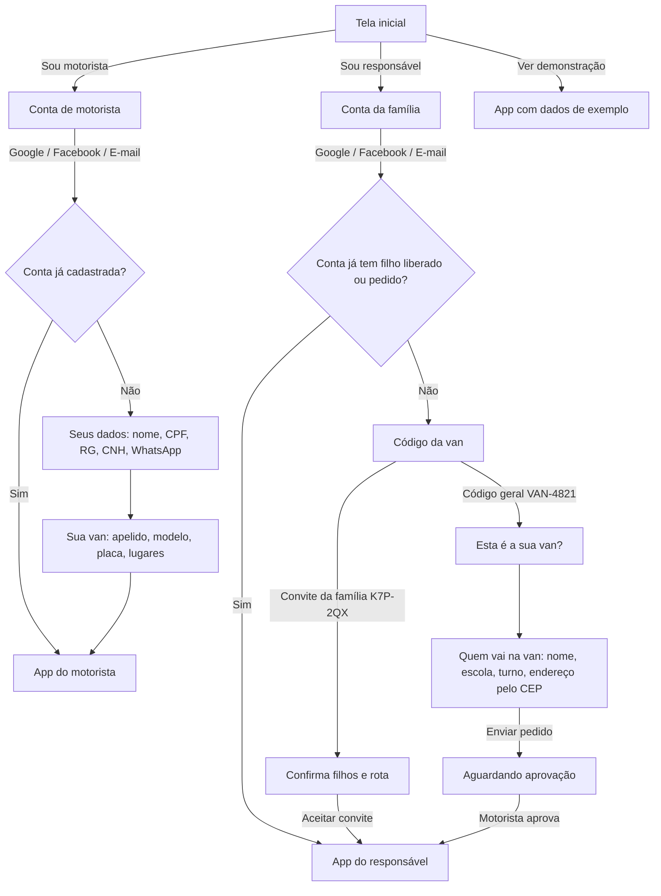

# Van Connect

Aplicativo de **transporte escolar** que conecta o motorista da van às famílias.
O responsável acompanha a van ao vivo no mapa, avisa ausências e paga as mensalidades;
o motorista organiza rotas, faz a chamada, cobra pelo app e cuida dos cadastros.

Feito em **Flutter** — o mesmo código roda em **Android** e **iPhone (iOS)**.

> **Status: protótipo funcional.**
> - O login com Google e Facebook é **simulado** (o app pede nome e e-mail). Para ligar o login de verdade, veja [Login de verdade](#11-login-de-verdade-google-e-facebook).
> - Os dados ficam **em memória** (somem ao fechar o app). Só a **sessão** (quem entrou) fica salva no aparelho.
> - CEP (ViaCEP), mapa (OpenStreetMap) e localização (GPS) são **reais**.

---

## Sumário

1. [Perfis e visão geral](#1-perfis-e-visão-geral)
2. [Como experimentar](#2-como-experimentar)
3. [Fluxo de entrada (contas)](#3-fluxo-de-entrada-contas)
4. [Fluxos do motorista](#4-fluxos-do-motorista)
5. [Fluxos do responsável](#5-fluxos-do-responsável)
6. [Fluxos compartilhados](#6-fluxos-compartilhados)
7. [Avisos automáticos](#7-avisos-automáticos)
8. [Regras de negócio](#8-regras-de-negócio)
9. [Mapa de telas](#9-mapa-de-telas)
10. [Como rodar e gerar o app](#10-como-rodar-e-gerar-o-app)
11. [Login de verdade (Google e Facebook)](#11-login-de-verdade-google-e-facebook)
12. [Arquitetura e estrutura](#12-arquitetura-e-estrutura)
13. [Testes automatizados](#13-testes-automatizados)
14. [Próximos passos](#14-próximos-passos)
15. [Versionamento](#15-versionamento)

---

## 1. Perfis e visão geral

| Perfil | Quem é | Abas |
|---|---|---|
| **Motorista** | Dono da(s) van(s). Cadastra alunos, colégios, rotas e recebe as mensalidades. | **Início · Rotas · Finanças · Gestão** |
| **Responsável** | Mãe, pai ou familiar do aluno. Só entra com o código da van. | **Mapa · Filhos · Avisos · Pagamentos · Ajustes** |

Um familiar convidado como **"Só acompanhar"** vê mapa e avisos, mas não marca ausência nem
informa pagamento (a aba *Pagamentos* some para ele).

O que é real e o que é simulado no protótipo:

| Recurso | Situação |
|---|---|
| CEP → endereço | **Real** ([ViaCEP](https://viacep.com.br)) |
| Endereço → ponto no mapa | **Real** ([Nominatim/OpenStreetMap](https://nominatim.org)) |
| Mapa | **Real** (OpenStreetMap, com filtro claro/escuro) |
| GPS ligado / permissão | **Real** (`geolocator`) — exigido para iniciar viagem |
| Sessão salva no aparelho | **Real** (`shared_preferences`) |
| Login Google / Facebook / e-mail | **Simulado** (interface pronta para Firebase) |
| Movimento da van na viagem | **Simulado** (a van anda sozinha pela rota) |
| Avisos | **Dentro do app** (push fica para o backend) |
| Banco de dados | **Em memória** (dados de demonstração) |

---

## 2. Como experimentar

### Instalar no Android
- Gere o instalador com `flutter build apk --release` (veja a [seção 10](#10-como-rodar-e-gerar-o-app))
  e instale o `app-release.apk` no celular.
- Ou conecte o celular com depuração USB e rode `flutter run --release`.

### Entrar sem criar conta
Na tela inicial, em **Ver demonstração**, toque em **Motorista** ou **Família**.

### Dados da demonstração
| Item | Valor |
|---|---|
| Motorista | **Rogério Nunes** — van principal + van reserva |
| Responsável de demonstração | **Mariana Costa**, mãe do **Lucas** e da **Helena** |
| Código geral da van | **`VAN-4821`** |
| Colégios | **Colégio Horizonte** e **Escola Ipê Amarelo** |
| Pedido pendente | **Benício Prado** (mãe Camila), com o colégio escrito errado ("Colegio Horisonte") para testar a correção |
| Convite da família | Gere em *Gestão › Alunos › (aluno) › Convidar* |

### Roteiro rápido de teste
1. **Motorista:** *Sou motorista* → *Continuar com Google* → nome e e-mail → CPF, RG e WhatsApp → modelo e placa da van → **Concluir cadastro**.
2. Em *Gestão › Alunos*, abra um aluno e toque em **Convidar** (o código do convite é copiado).
3. *Gestão › Sair* → **Sou responsável** → crie a conta → digite o código do convite → **Aceitar convite**.
4. Ou digite **`VAN-4821`** para fazer um pedido; na tela "aguardando aprovação" use **Simular aprovação do motorista**.

---

## 3. Fluxo de entrada (contas)



### 3.1 Motorista — criar a conta
1. **Tela inicial › Sou motorista** abre *Conta de motorista*, com o passo a passo (conta → seus dados → dados da van).
2. Escolha **Continuar com Google**, **Facebook** ou **E-mail**.
   - No protótipo abre uma folha pedindo **nome completo** e **e-mail** (no e-mail também **senha**, mínimo 6 caracteres).
   - No app publicado, aqui abre a janela do Google/Facebook.
3. **Seus dados** (passo 1 de 2):
   - Nome completo (nome e sobrenome).
   - **CPF** com máscara `000.000.000-00` e **validação dos dígitos verificadores**.
   - **RG**.
   - **CNH** (opcional; se preenchida, 11 números).
   - **WhatsApp** com DDD, máscara `(11) 98888-1020`.
   - Os erros aparecem embaixo de cada campo ao tocar em *Continuar*.
4. **Sua van** (passo 2 de 2):
   - Apelido (ex.: "Van azul").
   - Modelo e ano.
   - **Placa** validada: antiga `ABC-1234` ou Mercosul `ABC1D23` (a máscara coloca maiúsculas e o traço).
   - Lugares (4 a 30, sem contar o motorista).
   - "Voltar" no passo 2 volta para o passo 1, sem perder o que foi digitado.
5. **Concluir cadastro** → abre o app do motorista com o aviso **"Bem-vindo ao Van Connect"**.
   - A van cadastrada vira a **principal** e é a única da conta (as vans de demonstração saem).
   - Todas as rotas passam a usar essa van.
6. Entrar de novo com a **mesma conta** pula o cadastro.

> CPF, RG e CNH ficam só no cadastro do motorista. As famílias veem apenas o nome, a van e a placa.

### 3.2 Responsável — criar a conta e entrar com o código
1. **Tela inicial › Sou responsável** abre *Conta da família* → Google, Facebook ou E-mail.
2. Sem filho liberado, abre a tela **Código da van** — **sem código não há acesso ao app**.
3. **Convite da família** (ex.: `K7P-2QX`):
   - Mostra quem convidou, a van e a placa, os filhos e os horários da rota.
   - **Aceitar convite** → entra direto no app, já com os filhos.
   - **Não reconheço este convite** volta ao código.
4. **Código geral** (`VAN-4821`):
   1. *Esta é a sua van?* (nome do motorista, modelo e placa) → **Sim, é esta**.
   2. *Quem vai na van?* → nome da criança, **nome da escola por escrito** (o responsável não vê a lista de colégios do motorista), turno (manhã/tarde) e **endereço de embarque pelo CEP**, confirmado no mapa.
   3. **Enviar pedido** → entra no app na tela **"Aguardando aprovação"**, que mostra o pedido "Em análise" e o botão **Tenho um convite**.
   4. Quando o motorista aprova, o app libera o mapa e chega o aviso **"Pedido aprovado 🎉"**.
5. A conta **lembra os filhos**: quem sai e entra de novo com a mesma conta não precisa do código.

### 3.3 Sessão, sair e trocar de perfil
- **Sessão salva:** ao reabrir o app, a pessoa continua logada (perfil, conta, dados do motorista e filhos liberados).
- **Sair:** *Gestão › Sair* (motorista) ou *Ajustes › Sair* (responsável), com confirmação.
- **Ver como responsável / Ver como motorista:** atalhos da demonstração para alternar o perfil no mesmo aparelho.

---

## 4. Fluxos do motorista

### 4.1 Início
- Saudação e o **aviso mais recente** no topo (some ao dispensar). O **sino** abre a **Central de avisos**, com contador de não lidos.
- Cartão **PRÓXIMA VIAGEM** (ou **EM ANDAMENTO**) com **Iniciar viagem** / **Abrir viagem**.
- **Para hoje:** pedidos para entrar na van, ausências do dia, mensalidades para confirmar e aniversários da semana.
- **Agenda** com as viagens do dia (horário e quantidade de alunos).

### 4.2 Iniciar uma viagem
1. Toque em **Iniciar viagem** (Início) ou **Iniciar esta viagem** (detalhe da rota).
2. **Localização obrigatória.** Se a localização estiver:
   - **desligada** → folha *Ligue a localização*, com **Ligar localização**;
   - **sem permissão** → *Permita a localização*, com **Permitir**;
   - **bloqueada** → *Localização bloqueada*, com **Abrir ajustes do app**.

   A folha confere sozinha a cada 2 segundos e ao voltar para o app. A viagem só começa quando tudo
   estiver certo; **Agora não** cancela o início.
3. **Van em outro celular:** se a mesma van já estiver em viagem em outro aparelho da conta, o app
   pergunta **Iniciar mesmo assim?** (*Iniciar aqui* assume a van neste celular).
4. A viagem começa e as famílias da rota recebem **"A van saiu"**.

### 4.3 Viagem ao vivo (chamada)
- **Mapa** com a rota, as paradas e a van andando; topo com "Ao vivo · N famílias".
- Cartão **A caminho de** com a parada atual, o tempo estimado e os alunos daquela casa.
  - **Ida:** marque cada aluno como **Embarque** ou **Não veio**, ou use **Todos embarcaram**.
  - **Volta:** **Desembarque** / **Todos desceram**.
  - **Avisar que estou chegando** → a família recebe "A van está chegando! 🚐".
  - **Próxima parada** avança (com *Seguir automaticamente* ligado, avança sozinho).
- Irmãos ficam na **mesma parada**; quem avisou ausência **já sai da rota** (aparece em *Avisaram ausência*).
- Contadores: paradas feitas, a bordo, ausentes e quem não veio.
- **Linha do tempo** com cada embarque, entrega e aviso.
- **Emergência:** triângulo vermelho → **Enviar alerta** para todas as famílias. Tocar de novo → *Está tudo bem* encerra o alerta.
- **GPS desligado no meio da viagem:** cartão vermelho "Localização desligada: as famílias não estão
  recebendo a posição da van" com **Ligar localização**.
- **Sem sinal (simulação):** toque na antena para simular celular sem sinal; as famílias continuam vendo a última posição.
- **Encerrar** (confirmação) desliga o compartilhamento. Ao fim aparece **Viagem concluída** com transportados e quem não veio.

### 4.4 Rotas
**Lista:** rotas agrupadas por turno (manhã, tarde, integral), com ida/volta, horário de saída,
quantidade de alunos e o selo **Hoje alterada** quando o dia foi mudado.

**Criar rota** (botão +):
1. Turno, sentido (**Ida casa → escola** ou **Volta**) e horário de **Saída**.
2. **Colégio:** abre a seleção de colégios (dá para **cadastrar um novo** ali mesmo).
3. **Criar rota** → os alunos do turno e do colégio escolhidos **entram sozinhos**.

**Detalhe da rota:**
- Mapa com o percurso e o **percurso estimado** em km.
- **Quem vai hoje:** tirar ou incluir alunos **só no dia**, sem mexer na rota padrão.
  - **Salvar hoje como padrão** torna a mudança fixa (com confirmação).
  - **Desfazer mudanças de hoje** volta ao padrão.
- **Ordem de busca / entrega:** segure e arraste para mudar; **Otimizar ordem** calcula o menor caminho entre as casas.
- **Configuração:** horário de saída, **van desta rota** (ocupação × lugares), **escolas atendidas** e **Adicionar colégio**.
- **Editar rota padrão** (quem vai todos os dias) e **Excluir rota** (os alunos continuam cadastrados).

### 4.5 Alunos e pedidos (Gestão › Alunos)
**Alunos** — lista por turno, com **busca** por aluno ou responsável.

**Novo passageiro** (botão +):
1. Nome do aluno.
2. **Colégio:** *Selecione ou cadastre o colégio* (lista com busca, ou **Cadastrar novo colégio**).
3. Turno.
4. **Endereço de embarque pelo CEP** (obrigatório), confirmado no mapa — é ali que a van vai parar.
5. Nome do responsável, WhatsApp, mensalidade (R$), dia do vencimento e cuidados de saúde (opcional).
6. **Salvar e convidar família** → o aluno entra nas rotas do turno/colégio e já abre o **convite** para enviar pelo WhatsApp.

**Ficha do aluno:**
- **Ligar**, **Convidar** e **Cobrar**.
- Responsável, colégio (horários de entrada e saída), endereço de embarque, rotas, ausências avisadas e mensalidades.
- **Editar aluno:** nome, colégio (pela lista), turno, endereço pelo CEP, responsável, mensalidade e vencimento. Ao salvar, as rotas são ajustadas.
- **Pausar transporte:** sai das rotas e das próximas cobranças até ser reativado (**Reativar transporte**).

**Pedidos** (famílias que usaram o código `VAN-…`):
- Cada pedido mostra o que a família escreveu. Se o colégio não bater com nenhum cadastrado, aparece
  **Colégio "…" não confirmado**.
- **Editar pedido:** corrigir nome, **colégio (pela lista)**, turno, endereço pelo CEP, responsável e
  telefone. **Salvar** ou **Salvar e aceitar**.
- **Revisar e aceitar** (quando falta confirmar o colégio) ou **Aceitar** (quando o colégio já bate).
- **Recusar** (com confirmação; o responsável é avisado).
- Ao aceitar: vira aluno, entra nas rotas, ganha mensalidade e a família recebe **"Pedido aprovado 🎉"**.

**Código geral da van:** *Compartilhar* copia a mensagem com o `VAN-4821`. Para quem já é atendido,
o recomendado é **Convidar** pela ficha do aluno (vai com filho e rota, sem aprovação).

**Convite da família:**
- Código de 6 caracteres sem letras/números ambíguos, **uso único** e válido por **7 dias**.
- Inclui os **irmãos** (mesmo responsável) e pode ser **cancelado**.
- Gerar outro para o mesmo responsável substitui o anterior.
- Dá para convidar outro familiar com escopo **"Ver e agir"** ou **"Só acompanhar"**.

### 4.6 Colégios (Gestão › Escolas)
- Lista com endereço e horários; **busca** por nome.
- **Cadastrar colégio:** nome, **endereço pelo CEP** confirmado no mapa (para a rota passar no portão certo), horário de **entrada** e de **saída**.
- **Editar** e **Excluir** (não exclui se houver alunos no colégio).
- A mesma seleção aparece no *Novo passageiro*, no *Editar aluno*, no *Editar pedido* e na *Nova rota*.
- **As famílias não veem essa lista.**

### 4.7 Finanças
**Resumo do mês:**
- Anel com o **% recebido** e "Recebido em [mês] de R$ X previstos".
- Blocos coloridos: **Recebido** (verde), **A receber** (azul), **Atrasado** (vermelho).

**Ações:**

| Botão | O que faz |
|---|---|
| **Cobrar atrasados** (vermelho) | Confirma e envia um aviso no app para cada família atrasada, **com a chave Pix** para copiar. Sem chave, oferece cadastrar antes (ou *Cobrar sem Pix*). |
| **Lembrar antes** (âmbar) | Escolhe o prazo (3, 5, 7 ou 10 dias) e avisa quem vence nesse período e ainda não pagou. |
| **Chave Pix** (verde) | Cadastra/edita a chave: **CPF, celular, e-mail ou aleatória**, com validação, e o nome do titular. Ao salvar: **"Nova chave Pix adicionada"** (ou "atualizada") e as famílias são avisadas. |
| **Confirmar pagos** (roxo) | Aparece quando há famílias que tocaram em *Já paguei*: confirma os recebimentos. |
| **Gerar mensalidades** (azul) | Cria as mensalidades que faltam no mês. |

**Abaixo das ações:**
- Gráfico dos **últimos 6 meses** (previsto × recebido); tocar numa barra mostra o mês.
- Lista **A receber** e **Pagas**. Tocar numa mensalidade abre as ações:
  - registrar pagamento (Pix, dinheiro, transferência ou cartão);
  - **Confirmar recebimento**;
  - **Cobrar no app (com chave Pix)**;
  - **Copiar mensagem para WhatsApp**;
  - **Desfazer pagamento**.

### 4.8 Gestão
- **Cartão do motorista:** toque para abrir **Meus dados** (nome, CPF, RG, CNH, WhatsApp). Mostra a conta (Google/Facebook/E-mail).
- Atalhos: **Alunos** (com contador de pedidos), **Escolas**, **Vans**, **Código**.
- **Vans:**
  - **Principal** e **Reserva**, com **Tornar principal**.
  - Cadastrar, editar e excluir (com placa validada; não exclui a última).
  - As vans são **só do motorista**: nenhum outro motorista tem acesso.
- **Aparência:** claro, escuro ou automático.
- **Durante a viagem:**
  - *Compartilhar localização* (só durante a viagem);
  - *Avisar próxima família*;
  - *Seguir automaticamente*.
- **Rever tutoriais**, **Ver como responsável** (demonstração) e **Sair**.

---

## 5. Fluxos do responsável

### 5.1 Mapa (tela inicial)
- Mapa em tela cheia com **Casa**, colégio e a **van ao vivo**. Selos com os filhos no topo (troca de filho com um toque).
- **Aviso mais recente** flutuando logo abaixo dos filhos (ex.: cobrança, lembrete, chave Pix).
- **Painel** que muda conforme o momento:

| Situação | O que aparece |
|---|---|
| Sem viagem | "Ida às 06:35 — Você recebe um aviso quando a van sair." |
| Van a caminho | "A van está indo buscar Lucas", **Chega em ~N min**, **Faltam N paradas antes de você** |
| Próxima parada | "Você é a próxima parada" / "A van está chegando! — Hora de descer com a mochila 🎒" |
| A bordo | "Indo para a escola." |
| Entregue | "Chegou na escola" / "Chegou em casa" |
| Ausência avisada | "Ausência avisada — A parada saiu da rota de hoje", com **Vai sim** |
| Sem sinal do motorista | "A localização não está em tempo real (última há Ns)" — o mapa mostra a última posição |
| Emergência | Faixa vermelha "Alerta do motorista às HH:MM. Ligue para…" |

- Botões **Não vai hoje** e **Motorista** (ligar).

### 5.2 Ausência ("Não vai hoje") e presença ("Vai sim")
1. **Não vai hoje** (Mapa) ou **Avisar que não vai** (Avisos).
2. Escolha quem (se houver mais de um filho), **Hoje / Amanhã / Outro dia** e **Ida e volta / Só ida / Só volta**.
3. **Avisar motorista** → o motorista recebe **"Ausência avisada"** e a casa sai da rota daquele dia.
4. **Prazo:** depois que a rota daquele sentido **começa**, não dá mais para marcar nem desmarcar pelo app
   (aparece "A rota já começou. Para hoje, fale direto com o motorista."). Se só um sentido já começou,
   o aviso vale para o outro.
5. Para desfazer: **Vai sim** no mapa ou deslizar a ausência para a esquerda em *Avisos*.

### 5.3 Filhos
- Cartão de cada filho: idade e série, colégio e horário das aulas, **busca em casa** e **volta para casa**
  (horário de saída da van), endereço de embarque e **cuidados de saúde** (o motorista vê na chamada).
- **Aguardando o motorista:** pedidos enviados e ainda não aprovados.
- **Adicionar filho com convite** (ou +): convite da família ou código geral.

### 5.4 Avisos
- **Avisar que não vai** (atalho).
- **Recados do motorista:** cobranças, lembretes de vencimento e a chave Pix, com **Copiar chave Pix**; **Marcar todos como lidos**.
- **Hoje:** linha do tempo da viagem (saída, embarque, entrega, emergência).
- **Ausências marcadas** (deslize para marcar presença enquanto a rota não começou).

### 5.5 Pagamentos
- Total **em aberto** e a **chave Pix do motorista** (titular, tipo e chave) com **Copiar chave Pix**. Se o motorista ainda não cadastrou, o app avisa para combinar com ele.
- Cada mensalidade: **Já paguei** → fica **Confirmando** até o motorista confirmar.
- **Histórico** das pagas.

### 5.6 Ajustes
- Nome, telefone, conta (Google/Facebook/E-mail) e o escopo (**Ver e agir** / **Só acompanhar**).
- Aparência, notificações (van a caminho; embarque e chegada), **Rever tutoriais**, **Ver como motorista** (demonstração) e **Sair**.

---

## 6. Fluxos compartilhados

### 6.1 Endereço pelo CEP + confirmação no mapa
Usado no endereço de embarque (motorista e responsável) e no endereço dos colégios.
1. Digite o **CEP** (máscara `00000-000`): rua, bairro, cidade e UF aparecem sozinhos (ViaCEP).
   CEP inexistente ou sem internet mostra o erro no campo.
2. Complete **número** e **complemento** (dá para editar a rua).
3. **Localizar no mapa:** o app procura o ponto (Nominatim) e abre o mapa com um **pino fixo no centro**.
   - Arraste o mapa até o pino ficar na porta da casa e toque em **Confirmar local**.
   - Se o número exato não for achado, o app avisa e começa pela rua ou pelo CEP.
4. O cartão do endereço mostra um **mini mapa** com o ponto confirmado.

### 6.2 Central de avisos
- Abre pelo **sino** (motorista) ou pelos recados em *Avisos* (responsável).
- Cada aviso tem ícone e cor pelo tipo (pedido, ausência, pagamento, cobrança, lembrete, Pix, viagem, convite, sistema) e "há N min".
- Avisos com chave Pix têm **Copiar chave Pix**. Ao sair da central, os avisos são marcados como lidos.

### 6.3 Tutoriais interativos
- Ao tocar numa aba pela primeira vez, abre um pop-up com o passo a passo daquela aba (conteúdo próprio de cada perfil).
- Etapas deslizáveis e caixa **Não mostrar novamente** (fica salvo no aparelho).
- *Gestão/Ajustes › Rever tutoriais* reativa todos.

### 6.4 Diálogos e componentes
Componentes próprios, neutros entre Android e iPhone:
- confirmações com ícone e botões arredondados;
- folhas de ações que sobem de baixo;
- seletores em pílula, chaves (switch) e seletor de horário em grade.

---

## 7. Avisos automáticos

| Quando | Quem recebe | Aviso |
|---|---|---|
| Responsável envia pedido com o código geral | Motorista | "Novo pedido para entrar na van" |
| Motorista aprova o pedido | Família | "Pedido aprovado 🎉" |
| Família aceita convite | Motorista | "Convite aceito" |
| Família avisa ausência | Motorista | "Ausência avisada" |
| Família toca em *Já paguei* | Motorista | "Pagamento para confirmar" |
| Motorista cadastra/edita a chave Pix | Motorista e famílias | "Nova chave Pix adicionada" / "Chave Pix do motorista" |
| *Cobrar atrasados* ou *Cobrar* | Família | "Mensalidade de [filho] em atraso" (com a chave Pix) |
| *Lembrar antes* | Família | "Lembrete: mensalidade de [filho]" (com a chave Pix) |
| Viagem começa | Famílias da rota | "A van saiu" |
| *Avisar que estou chegando* | Família da parada | "A van está chegando! 🚐" |
| Botão de emergência | Famílias da viagem | "Alerta de emergência" |
| Cadastro do motorista concluído | Motorista | "Bem-vindo ao Van Connect" |

O aviso mais recente aparece **na tela inicial** dos dois perfis (Início do motorista e Mapa do responsável).

---

## 8. Regras de negócio

- **Acesso do responsável:** só com **convite** (entra na hora) ou **código geral** (precisa de aprovação). Conta sem filho liberado vê apenas a tela de espera ou a de código.
- **Colégios são do motorista:** o responsável escreve o nome; o app sugere o colégio quando o nome bate (ignorando acentos e maiúsculas). Sem o colégio confirmado, o pedido **não pode ser aprovado**.
- **Vans:** cada motorista tem só as próprias vans (principal + reserva). Nenhuma van é acessível a outro motorista.
- **Mesma van em dois celulares:** o app avisa antes de iniciar e pede para assumir.
- **Localização:** sem GPS ligado e permitido, a viagem não começa; durante a viagem, a localização só é compartilhada enquanto ela está em andamento.
- **Ausência:** pode ser marcada/desmarcada até a rota do sentido começar; depois, só com o motorista.
- **Rota do dia × padrão:** mudanças em "Quem vai hoje" valem só para o dia, a não ser que sejam salvas como padrão.
- **Convite:** 6 caracteres, uso único, 7 dias, inclui irmãos, pode ser cancelado; escopos *Ver e agir* / *Só acompanhar*.
- **Cobrança:** vai com a chave Pix quando cadastrada; *Já paguei* depende da confirmação do motorista.
- **Pausar aluno:** sai das rotas e das próximas cobranças até ser reativado.
- **Validações:** CPF (dígitos verificadores), placa (antiga ou Mercosul), telefone com DDD, e-mail, CEP com 8 números, chave Pix conforme o tipo.

---

## 9. Mapa de telas

```
Tela inicial
├── Conta de motorista ── Seus dados ── Sua van ──► App do motorista
├── Conta da família ── Código da van ─┬─ Convite ──► App do responsável
│                                      └─ VAN-… ── Pedido ── Aguardando aprovação
└── Ver demonstração (Motorista | Família)

App do motorista
├── Início ── Central de avisos
│          └─ Iniciar viagem ── (Localização obrigatória) ── Viagem ao vivo
├── Rotas ── Nova rota (Selecionar colégio)
│        └─ Detalhe da rota (Quem vai hoje · Ordem · Configuração · Editar padrão)
├── Finanças ── Chave Pix · Cobrar atrasados · Lembrar antes · Mensalidade
└── Gestão ── Meus dados
           ├─ Alunos ── Novo passageiro · Ficha do aluno · Editar aluno · Convite
           │         └─ Pedidos ── Editar pedido
           ├─ Escolas ── Cadastrar/editar colégio (Endereço pelo CEP)
           ├─ Vans ── Nova/editar van
           └─ Código geral · Aparência · Viagem · Tutoriais · Sair

App do responsável
├── Mapa ── Não vai hoje · Motorista
├── Filhos ── Conectar van (convite ou código)
├── Avisos ── Recados do motorista · Ausências
├── Pagamentos ── Copiar chave Pix · Já paguei
└── Ajustes ── Aparência · Notificações · Tutoriais · Sair
```

---

## 10. Como rodar e gerar o app

Pré-requisitos: [Flutter](https://docs.flutter.dev/get-started/install) 3.44+ (Dart 3.12+).

```bash
flutter pub get
flutter run              # escolhe o aparelho conectado
flutter run --release    # versão rápida (sem modo debug)
flutter test             # testes automatizados
flutter analyze          # análise estática
```

### Android
- Conecte o celular com **depuração USB** e rode `flutter run`.
- Instalador: `flutter build apk --release` → `build/app/outputs/flutter-apk/app-release.apk`.
- Permissões usadas: internet e localização (precisa e aproximada).

### iPhone (iOS)
Compilar para iPhone exige **macOS com Xcode**.
1. `flutter pub get` → `cd ios && pod install` → abra `ios/Runner.xcworkspace` no Xcode.
2. Em *Signing & Capabilities*, escolha o time (Apple ID) e ajuste o *Bundle Identifier* (`app.vanconnect.vanConnect`).
3. Conecte o iPhone e rode `flutter run`.

Sem Mac: **Codemagic** ou **GitHub Actions (runner macOS)** para gerar o `.ipa` e enviar ao TestFlight.
O texto da permissão de localização já está no `Info.plist`.

### Web (só para visualizar)
`flutter build web` e sirva a pasta `build/web` (ex.: `python -m http.server`).

### Ícone do app
- Imagens em `icone/`, geradas a partir de `assets/logo.png` por `icone/gerar.py` (precisa do Pillow).
- Para aplicar em Android (inclusive ícone adaptativo) e iOS: `dart run flutter_launcher_icons`.

---

## 11. Login de verdade (Google e Facebook)

O app usa uma interface única, `AutenticacaoServico` (`lib/servicos/autenticacao_servico.dart`).
Hoje ela é `AutenticacaoDemonstracao`. Para o login real:

1. **Firebase:**
   - Crie um projeto no [console do Firebase](https://console.firebase.google.com).
   - Adicione os apps Android (`app.vanconnect.van_connect`) e iOS (`app.vanconnect.vanConnect`).
   - Rode `flutterfire configure` (gera `lib/firebase_options.dart`).
2. **Pacotes:** `flutter pub add firebase_core firebase_auth google_sign_in flutter_facebook_auth`.
3. **Google:**
   - Em *Authentication › Sign-in method*, ative o Google.
   - Android: cadastre o **SHA-1** e o **SHA-256** da chave de assinatura (`cd android && ./gradlew signingReport`).
   - iOS: adicione o `REVERSED_CLIENT_ID` do `GoogleService-Info.plist` em *URL Types*.
4. **Facebook:**
   - Crie o app em [developers.facebook.com](https://developers.facebook.com) e ative o login do Facebook no Firebase (App ID + App Secret).
   - Android: configure `facebook_app_id` e `facebook_client_token` no `strings.xml`.
   - iOS: configure `FacebookAppID`, `FacebookClientToken` e o URL scheme `fb<APP_ID>` no `Info.plist`, conforme a documentação do `flutter_facebook_auth`.
5. **E-mail:** ative *E-mail/senha* no Firebase.
6. Crie `AutenticacaoFirebase implements AutenticacaoServico`, usando:
   - `GoogleSignIn().signIn()` e `FacebookAuth.instance.login()`;
   - `FirebaseAuth.instance.signInWith…`.

   Depois passe no `main.dart`: `VanStore(auth: AutenticacaoFirebase())`. O resto do app não muda.

Os dados do cadastro (CPF, RG, CNH, van) e os vínculos família ↔ aluno devem ir para o banco
(ex.: Firestore), com regras de acesso por conta — cada van pertence a um único motorista.

---

## 12. Arquitetura e estrutura

- **Estado:** `VanStore` (`ChangeNotifier`) exposto por `VanScope` (`InheritedNotifier`), sem pacotes extras.
  A posição da van usa um `ValueNotifier` separado: só o mapa redesenha a cada quadro.
- **Serviços trocáveis** (injetados no `VanStore`):
  - `AutenticacaoServico` — login;
  - `EnderecoServico` — CEP e geocodificação;
  - `LocalizacaoServico` — GPS (há versões falsas para testes).
- **Tema:** `Paleta` (azul, cinza e branco) com modo claro e escuro, como `ThemeExtension`.

```
lib/
├── main.dart                 # app, temas, sessão salva e troca de perfil
├── app/
│   ├── tema.dart             # Paleta de cores, claro/escuro
│   ├── formatos.dart         # moeda, datas e horários em pt-BR
│   ├── geo.dart              # posição no mapa ↔ latitude/longitude
│   └── validacoes.dart       # CPF, placa, telefone, e-mail
├── servicos/
│   ├── autenticacao_servico.dart  # login (demonstração; Firebase em produção)
│   ├── sessao_salva.dart          # sessão no aparelho (shared_preferences)
│   ├── endereco_servico.dart      # CEP (ViaCEP) e localização (Nominatim)
│   └── localizacao_servico.dart   # GPS obrigatório (geolocator)
├── dominio/modelos.dart      # Aluno, Escola, Endereco, Veiculo, Trajeto, Viagem, Cobranca, Aviso, ChavePix…
├── dados/semente.dart        # dados de demonstração
├── estado/van_store.dart     # regras: cadastros, pedidos, convites, viagem, finanças, avisos
├── componentes/
│   ├── ui.dart               # kit visual (Secao, Linha, Botao, Segmentos, Formulario, diálogos…)
│   ├── mascaras.dart         # máscaras de CPF, telefone e placa
│   ├── mapa.dart             # mapa (flutter_map) com rota e van animada
│   └── aparencia.dart        # seletor claro/escuro/automático
├── tutoriais/                # conteúdo e pop-up dos tutoriais por aba
└── telas/
    ├── entrada/              # boas-vindas, conta, cadastro do motorista, código da van
    ├── comum/                # endereço por CEP + mapa, colégios, central de avisos
    ├── motorista/            # início, rotas, viagem, finanças, gestão, passageiros, localização
    └── responsavel/          # mapa, filhos, avisos, pagamentos, ajustes, conectar van, aguardando
icone/                        # imagens-fonte e gerador do ícone do app
test/widget_test.dart         # testes automatizados
```

**Principais pacotes:**
- `flutter_map` + `latlong2` — mapa;
- `geolocator` — GPS;
- `http` — ViaCEP e Nominatim;
- `shared_preferences` — sessão e tutoriais;
- `flutter_localizations` — pt-BR;
- `flutter_launcher_icons` — ícone (dev).

---

## 13. Testes automatizados

`flutter test` roda **30 testes**, entre eles:

**Contas e cadastro**
- Cadastro completo do motorista pela interface: Google, CPF inválido e depois válido, placa, van principal.
- Responsável sem código não entra; convite inválido e válido.
- Pedido com espera e aprovação; a conta lembra os filhos.
- Sessão salva e apagada ao sair.
- CPF, placa, telefone e máscaras.

**Endereço, GPS e pedidos**
- CEP: encontrado, inexistente, curto e sem internet (cliente HTTP simulado).
- GPS: permissão e queda no meio da viagem.
- Pedido com colégio errado: corrigir e só aprovar com o colégio confirmado; sugestão de colégio sem acento.

**Finanças**
- Chave Pix nova/atualizada, cobrança com Pix, lembrete antes do vencimento e avisos lidos.

**Rotina**
- Viagem pula ausentes e agrupa irmãos.
- Otimização de rota, rota do dia × padrão, prazo da ausência e paradas restantes.
- Sinal fraco e van em dois celulares.
- Convites (código, uso único, validade, irmãos, escopo).
- Tutoriais e modo escuro.

---

## 14. Próximos passos

- [ ] **Backend:** Firebase Auth ([acima](#11-login-de-verdade-google-e-facebook)) + Firestore no lugar dos dados em memória.
- [ ] **GPS em segundo plano** durante a viagem (serviço em primeiro plano no Android, *background modes* no iOS).
- [ ] **Convites no backend** (`convites/{codigo}` + Cloud Function) e links com App Links/Universal Links.
- [ ] **Notificações push** (Firebase Cloud Messaging) para os avisos que hoje ficam no app.
- [ ] **Provedores para produção:** OpenStreetMap e Nominatim públicos são para testes
      ([política de uso](https://operations.osmfoundation.org/policies/tiles/)); use MapTiler,
      Stadia Maps, Mapbox ou Google (com chave).
- [ ] Rotas pelas ruas de verdade (ex.: OSRM).
- [ ] Pagamento Pix com QR Code dinâmico e baixa automática (PSP/banco).
- [ ] Tela de abertura (`flutter_native_splash`).

---

## 15. Versionamento

```bash
git checkout -b feature/nome-da-melhoria   # nova funcionalidade
git add .
git commit -m "Descreve o que mudou"
git push -u origin feature/nome-da-melhoria # depois abra um Pull Request para a main
```

Mapa: dados © [OpenStreetMap](https://www.openstreetmap.org/copyright) contributors · CEP: ViaCEP.
